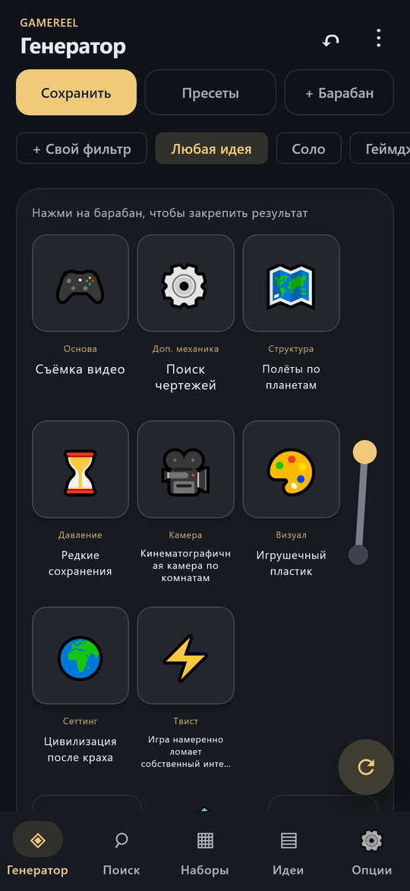
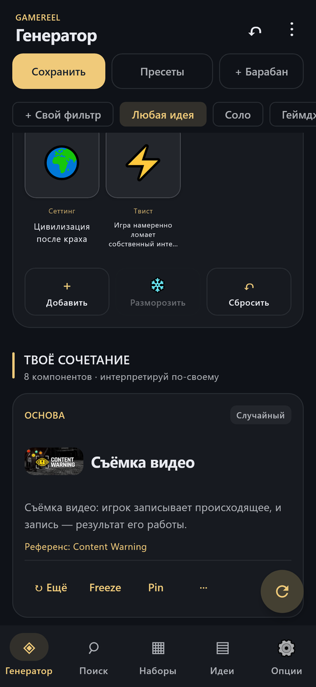
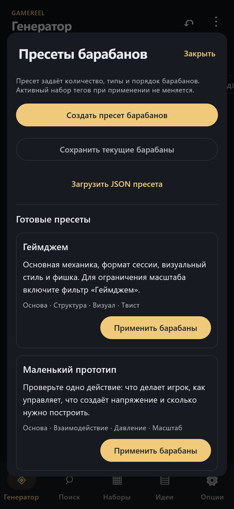
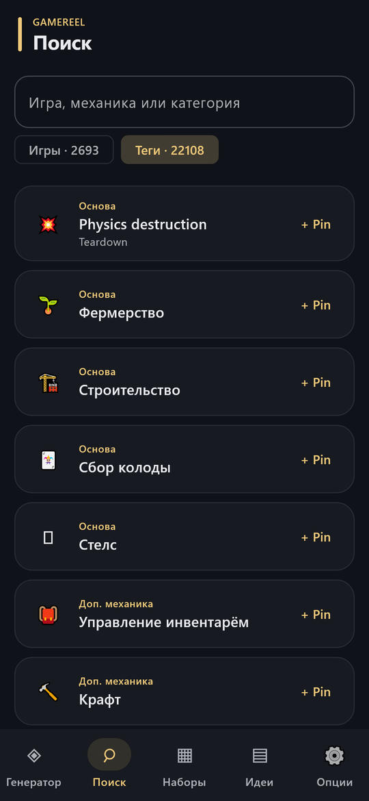
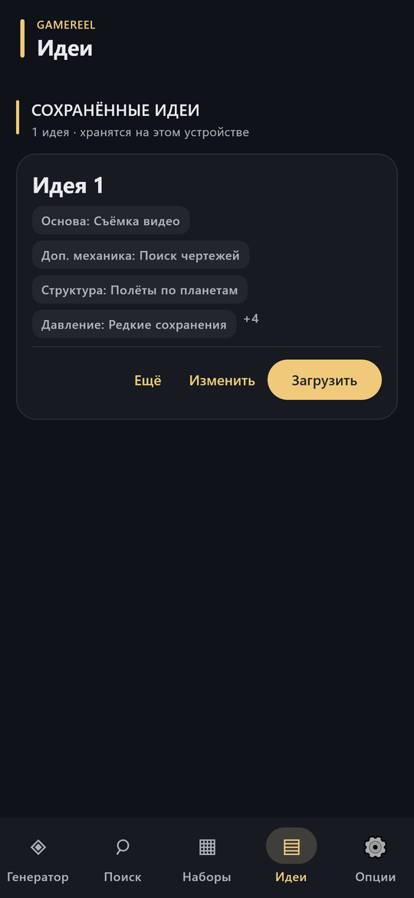
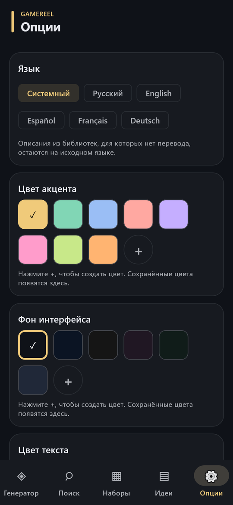

# GameReel

Генератор игровых идей в виде слот-машины. Крутите барабаны с механиками, сеттингами,
визуальным стилем, давлением и твистами, закрепляйте удачные компоненты и сохраняйте
сочетания как заготовки для будущих проектов.

Приложение написано на Kotlin Multiplatform и Compose Multiplatform и работает полностью
офлайн: Android, Desktop (JVM), Web (Wasm/JS) и iOS.

Веб-версия: <https://restor-0o0.github.io/GameReel/>

<p align="center">
  
  
  
</p>
<p align="center">
  
  
  
</p>

## Возможности

- **Восемь барабанов**: основа, доп. механика, структура, давление, камера, визуал, сеттинг
  и твист. Барабаны можно добавлять, замораживать (Freeze) и закреплять (Pin).
  Анимацию и звук можно отключить.
- **Режимы и фильтры**: «Любая идея», соло, геймджем, мобильная игра, офлайн. Свой фильтр
  исключает слова из названий тегов и закрепляет источники. Режимы задают масштаб,
  а не оценивают выполнимость.
- **Идея дня**: одно сочетание на сутки по UTC, одинаковое у всех. Строится только
  из встроенных тегов, поэтому импортированные библиотеки на него не влияют.
- **Ссылки на идеи**: «Копировать ссылку» кодирует барабаны в адрес вида
  `https://restor-0o0.github.io/GameReel/#idea=GR1.…`. Ссылка открывается в веб-версии
  и в Android-приложении, код `GR1.…` можно вставить через «Открыть по ссылке…».
  Неизвестные теги из чужих библиотек приходят как текст.
- **Пресеты барабанов**: семь встроенных шаблонов и свои наборы категорий. Применение
  пресета отменяется кнопкой ↶.
- **Синергии и редкие пары**: после остановки показываются совпадения с десятью авторскими
  правилами и до двух редко встречающихся пар механик в выбранных наборах.
- **Идеи и проекты**: сохранённую идею можно развить (концепция, игровой цикл, цель,
  фишка), сгруппировать по проекту, сделать от неё вариант и сравнить варианты.
  У идеи есть статус (идея, прототип, геймджем, выпущена, отложена) и ссылка на результат,
  список фильтруется по статусу. Карточка экспортируется в текст или SVG.
- **Поиск** по играм, механикам и категориям, с референсами (до трёх игр на тег).
- **Рынок**: популярность тегов по Steam (оценка владельцев) и Google Play (установки):
  суммарная аудитория, самый большой хит, медиана, число игр и хитов, доля рынка, средний
  рейтинг и топ-5 игр по тегу. Фильтр «Место тега» оставляет только игры, где тег стоит
  на первых местах (в Steam порядок задают голоса игроков). У референсов в карточках показана примерная аудитория.
  Это оценки аудитории, а не продажи. Пересчитывается `tools/build_bundled_libraries.py`.
- **Свои данные**: импорт библиотек и пресетов в JSON, коллекция «Мои игры», полный
  JSON-бэкап рабочего пространства. Готовые пресеты, наборы тегов и библиотеки от
  сообщества лежат в [community/](community/README.md).
- **Пять языков интерфейса**: русский, английский, испанский, французский, немецкий;
  переключаются без перезапуска. Цвет акцента и фона настраивается.

## Данные

| Библиотека | Объём |
| --- | --- |
| Steam Broad | 1000 игр |
| Steam All-Time | 1000 игр |
| Google Play | 1000 игр по текущим установкам (срез октября 2026) |
| itch.io · Selected | 28 игр, 120 тегов, ссылки на страницы авторов |
| Теги GameReel | 1461 тег в 18 категориях, без привязки к играм |

Описания, теги и игры-референсы проверены вручную, правки лежат в
`tools/library_sources/review`. Кнопка «Объединить все библиотеки» включает общий пул,
в том числе импортированные наборы. Редкость считается только по выбранным размеченным
наборам и не доказывает уникальность идеи.

Обложки игр (`tools/store_art`) хранятся только в репозитории и не входят ни в одну сборку:
приложение не показывает чужие картинки, см. [PLAY_BUILD.md](docs/PLAY_BUILD.md).

## Сборка и запуск

Нужны JDK 17+ и Android SDK (compileSdk 37). iOS собирается на macOS в Xcode из `app/iosApp`.

```powershell
.\gradlew.bat :app:desktopApp:run                       # Desktop
.\gradlew.bat :app:androidApp:assembleDebug             # Android APK
.\gradlew.bat :app:webApp:wasmJsBrowserDevelopmentRun   # Web (Wasm)
.\gradlew.bat :app:webApp:jsBrowserDevelopmentRun       # Web (JS)
```

Debug APK появляется в `app/androidApp/build/outputs/apk/debug/androidApp-debug.apk`.

Проверки:

```powershell
.\gradlew.bat :core:jvmTest :app:shared:jvmTest
python tools/check_localizations.py
python tools/validate_community.py --check
```

### Мобильные варианты релиза

`tools/build_mobile.ps1 -Variant All` собирает три варианта: локальный APK с обложками,
отдельный Preview APK без обложек и Play AAB с редакторским каталогом. Play AAB требует
upload-подписи: ключи берутся из переменных окружения `GAMEREEL_UPLOAD_*` и в репозитории
не хранятся. Графика магазина лежит в `release/store`. Подробности:
[PLAY_BUILD.md](docs/PLAY_BUILD.md), [RELEASE_1.3.0.md](docs/RELEASE_1.3.0.md).

Веб-версия и [политика конфиденциальности](https://restor-0o0.github.io/GameReel/privacy/)
публикуются на GitHub Pages workflow `pages.yml` при каждом push в `main`.

### Обновление встроенных наборов

При наличии `tools/library_sources/*/data/games_1000.json`:

```powershell
python tools/build_bundled_libraries.py
python tools/fetch_store_images.py
```

Второй скрипт загружает Steam header и иконки Google Play в WebP (в сборку не попадают)
(кэш в `tools/library_sources/store_images.json`, `--refresh` перезапрашивает всё),
ищет арт для игр-референсов (`ref_*.webp` + `references.txt` в `tools/store_art`, `--retry-missing`
повторяет ненайденные) и поднимает версию наборов. Его нужно запускать после каждой сборки
наборов. Новые метаданные магазинов автоматически не запрашиваются: срез Google Play
обновляет `tools/library_sources/google_play/scripts/refresh_snapshot.py`
(нужен `pip install google-play-scraper`), после него снова запускаются оба скрипта.

## Структура

| Модуль | Назначение |
| --- | --- |
| `core` | Модели, генерация, синергии, операции с рабочим пространством, контракт хранения. Без текстов UI. |
| `app/shared` | Экраны Compose, ViewModel, импорт, SQLDelight-хранилище, ресурсы и локализация. |
| `app/androidApp`, `desktopApp`, `webApp`, `iosApp` | Платформенные точки входа. |
| `tools` | Генераторы библиотек, загрузка арта, сборка релизов и графики магазина. |

Стек: Kotlin 2.4, Compose Multiplatform 1.12, Material 3, SQLDelight 2.3,
kotlinx.serialization, FileKit.

Строки интерфейса лежат в `app/shared/src/commonMain/composeResources/values*/strings.xml`.
Короткие имена тегов задаются в `ui/presentation/TagShortNames.kt`, подписи enum — в
`ui/presentation/TagPresentation.kt`.

## Документация

- [Архитектура и правила хранения](docs/ARCHITECTURE.md)
- [Состояние реализации](docs/IMPLEMENTATION_STATUS.md)
- [Аудит пресетов и тегов](docs/PRESET_AUDIT.md)
- [Производительность прокрутки](docs/SPIN_PERFORMANCE.md)
- [Проверка релиза и ограничения](docs/RELEASE_REVIEW_AND_ROADMAP.md)
- [Карточка Google Play](docs/STORE_LISTING.md) ·
  [выпуск 1.3.0 в Google Play](docs/RELEASE_1.3.0.md) ·
  [политика конфиденциальности](site/privacy/index.html)
- [Правила оформления кода](docs/CODE_STYLE.md)

GameReel — независимый инструмент. Упомянутые игры и площадки не являются партнёрами
проекта, их названия используются как справочные примеры.
